# RHCSA EX200 Exam Simulator

A self-contained simulator for the **Red Hat Certified System Administrator
(RHCSA / EX200)** exam: a timed task paper, real configuration work on a live
system, automated grading (including after a reboot), and a scored per-task
report.

- **RHEL 9 and RHEL 10, detected automatically.** On RHEL 10 you get the RHCSA 10
  objectives (Flatpak, systemd timers, GPT-only partitioning); on RHEL 9 the
  RHCSA 9 set. Nothing to choose.
- **250+ task templates per release** across every objective. Most randomize their values
  (users, sizes, ports, paths) on every run, so papers can't be memorized.
- **Single-node and two-node exams.** A two-node exam pairs two VMs and grades both
  from node1, like the real remote exam.
- **Practice modes** with hints, worked solutions and instant checks, plus mock
  exams, timed drills and a troubleshooting gym.
- **Fully offline.** Packages (and the RHEL 10 Flatpak repo) come from the RHEL
  install DVD attached to the VM. No subscription or internet needed after install.

> ⚠️ **Use disposable virtual machines only.** The simulator creates and deletes
> users, partitions, logical volumes, services and firewall/SELinux rules.
> `start` and `reset` delete every regular user (UID ≥ 1000) except `student`,
> members of `wheel`, and the user running `sudo`. **Take a VM snapshot before
> you start**, and keep nothing on the VM that you need.

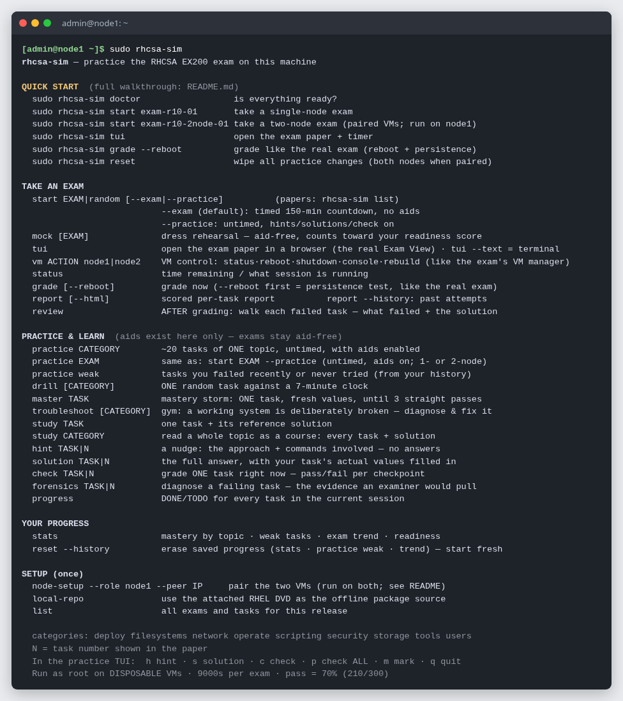

---

## Contents

1. [Prepare the VM](#1-prepare-the-vm) (both setups)
2. [Install the simulator](#2-install-the-simulator) (both setups)
3. [Single-node exam](#3-single-node-exam) (one VM)
4. [Two-node exam](#4-two-node-exam) (two VMs)
5. [Practice modes](#5-practice-modes)
6. [Updating](#updating) · [Troubleshooting](#troubleshooting) · [RHCSA 9 vs. RHCSA 10](#rhcsa-9-vs-rhcsa-10)

**Which setup?** Start with **single-node**: one VM, about 15 minutes to set up.
Move to **two-node** when you want the real exam layout. It is the same install
done on a second VM, plus a one-time pairing step.

| | Single-node | Two-node |
|---|---|---|
| VMs | 1 | 2 (**node1** and **node2**), same RHEL version, same network |
| Papers (RHEL 9) | `exam-01` … `exam-05` | `exam-2node-01` … `exam-2node-08` |
| Papers (RHEL 10) | `exam-r10-01`, `exam-r10-02` | `exam-r10-2node-01` … `03` |
| You run commands on | the VM | **node1** for everything; node2 only for its own tasks |

---

## 1. Prepare the VM

Create a VM in virt-manager, VirtualBox, VMware, Proxmox or similar. For a
two-node exam, create **two** VMs like this.

| Setting | What you need |
|---|---|
| OS | **RHEL 9 or RHEL 10** (Rocky, AlmaLinux and CentOS Stream 9/10 also work). Minimal install is enough. |
| Memory | 2 GB or more |
| Disk 1 | the OS disk (about 12 GB or more) |
| Disk 2 | a **blank** spare disk (2–5 GB) for the storage tasks. In the RHEL installer, **only select disk 1** under *Installation Destination*. If the installer uses both disks, there is nothing left to practise on. |
| CD-ROM | the **RHEL install DVD ISO**, left attached after installation. It is the offline package source. |
| User | an administrator account (in the installer, tick *Make this user administrator*). This guide uses `admin`. |
| Network | the VM must reach the internet once, to download the simulator. For two-node, both VMs must reach each other (any shared NAT or bridged network). |

After installing RHEL, log in and check the disks. You should see the OS on
`vda`, a **blank** `vdb` with no partitions, and the DVD as `sr0` (names can differ
on VirtualBox/VMware, e.g. `sda`/`sdb`):

```bash
lsblk
```

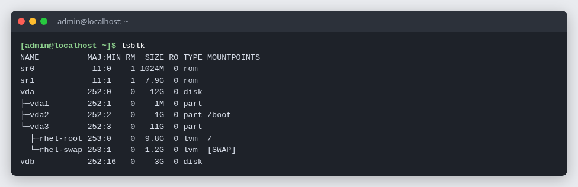

Now **take a snapshot** of the VM, so you can always get back to this clean state.

---

## 2. Install the simulator

Do this on every VM (both of them for two-node). A minimal RHEL install has no
`git` and no package repositories yet, so download the code with `curl`:

```bash
curl -LO https://github.com/ambawatyuvaraj/rhcsa-exam-simulator/archive/refs/heads/main.tar.gz
tar xzf main.tar.gz
cd rhcsa-exam-simulator-main
sudo ./install.sh
```

The installer detects your RHEL version, sets up the DVD as the package source,
installs the `rhcsa-sim` command, and finishes with `rhcsa-sim doctor`. **Every
line of the doctor output should be green `[+]`.** The *"This system is not
registered"* message near the top is harmless, because packages come from the DVD.

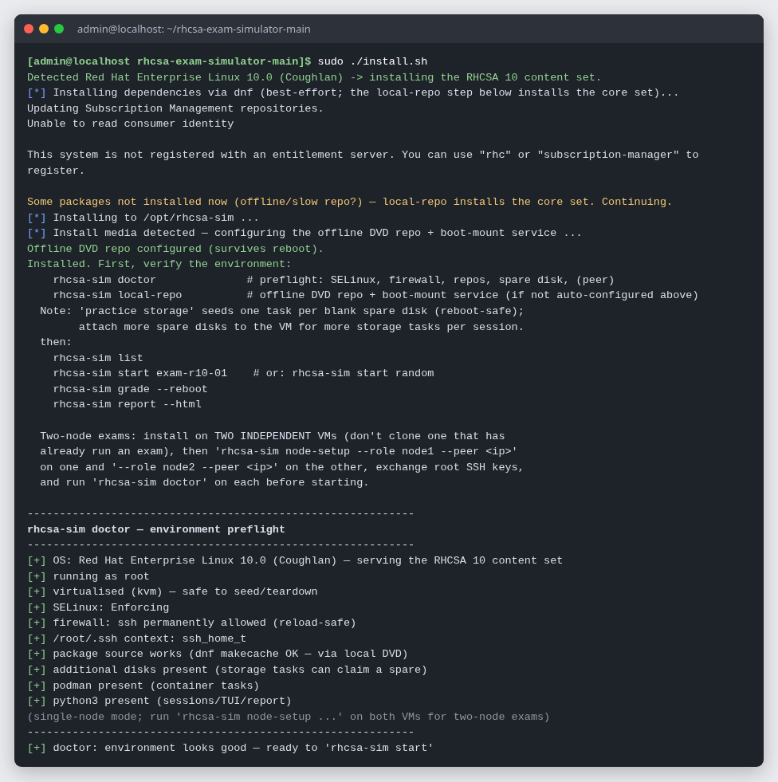

If doctor shows a red `[x]` or yellow `[!]` line, it tells you how to fix it; see
also [Troubleshooting](#troubleshooting). You can re-run the check any time with
`sudo rhcsa-sim doctor`.

<details>
<summary>Already have <code>git</code>? You can clone instead.</summary>

```bash
git clone https://github.com/ambawatyuvaraj/rhcsa-exam-simulator.git
cd rhcsa-exam-simulator
sudo ./install.sh
```
</details>

---

## 3. Single-node exam

### 3.1 Pick a paper and start it

```bash
sudo rhcsa-sim list                  # papers available on this RHEL version
sudo rhcsa-sim start exam-r10-01     # RHEL 10.  On RHEL 9: sudo rhcsa-sim start exam-01
```

`list` shows the papers first, then every task. **Two-node papers won't start on
an unpaired VM**; pick a paper without `2node` in its name.

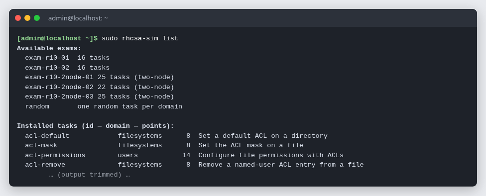

`start` asks you to type `CONFIRM`, then seeds the tasks and starts a 150-minute
timer:

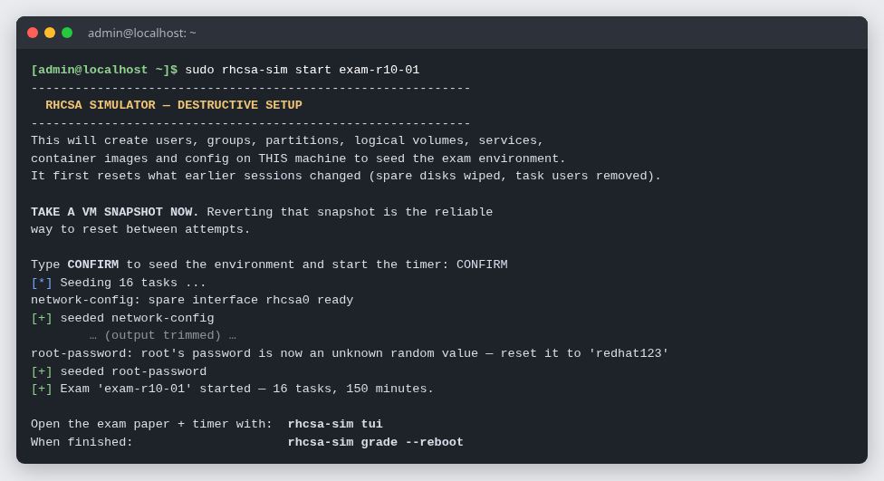

> 🔑 Some papers include **"reset the root password"**, so root's password is
> unknown once the exam starts. Keep using your admin account with `sudo`, or log
> in as `student` / `password`. Do the root-password task from the **VM console**.

### 3.2 Open the exam paper

```bash
sudo rhcsa-sim tui
```

- **VM with a desktop** (installed with *Server with GUI*): run it in a terminal on
  the VM's desktop and Firefox opens the paper.
- **Headless / minimal VM** (most setups): it prints an address and keeps running.
  Leave it running.

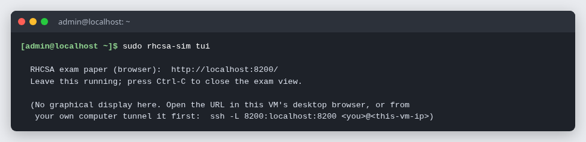

  On **your own computer**, open an SSH tunnel to the VM (use your VM's IP; find it
  with `hostname -I` on the VM), then browse to **http://localhost:8200**:

  ```bash
  ssh -L 8200:localhost:8200 admin@192.168.122.185
  ```

- **Prefer the terminal?** Use `sudo rhcsa-sim tui --text`.

The paper looks like the real exam. Task titles stay hidden until you open a task,
and the timer runs in the sidebar:

| Exam paper | A task |
|:---:|:---:|
| 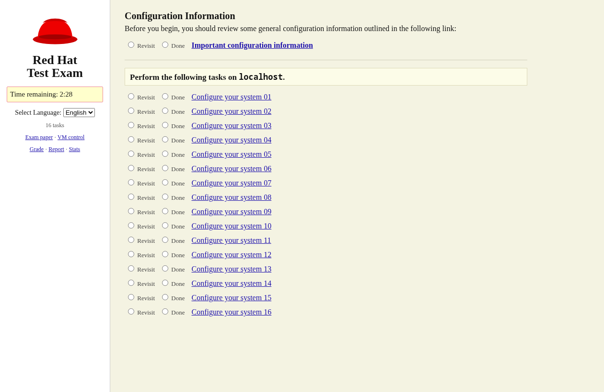 | 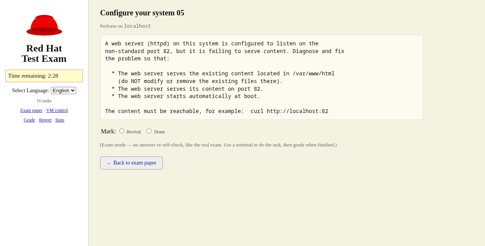 |

### 3.3 Do the tasks

Work in a normal terminal on the VM (SSH or console) as root (`sudo -i`). You can
reboot whenever you like to check your changes persist. The timer and paper
resume when you run `sudo rhcsa-sim tui` again.

### 3.4 Grade

```bash
sudo rhcsa-sim grade --reboot
```

This reboots the VM, like the real exam, so only changes that survive a reboot
score. If you are connected over SSH, the connection drops. That is expected.

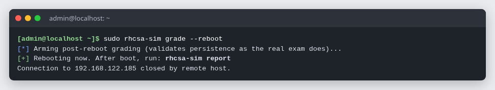

Grading runs by itself about 40 seconds after the VM is back up. Log in again and
read the result:

```bash
sudo rhcsa-sim report      # per-task, per-checkpoint result; 210/300 to pass
sudo rhcsa-sim review      # every failed task with what was wrong and the solution
```

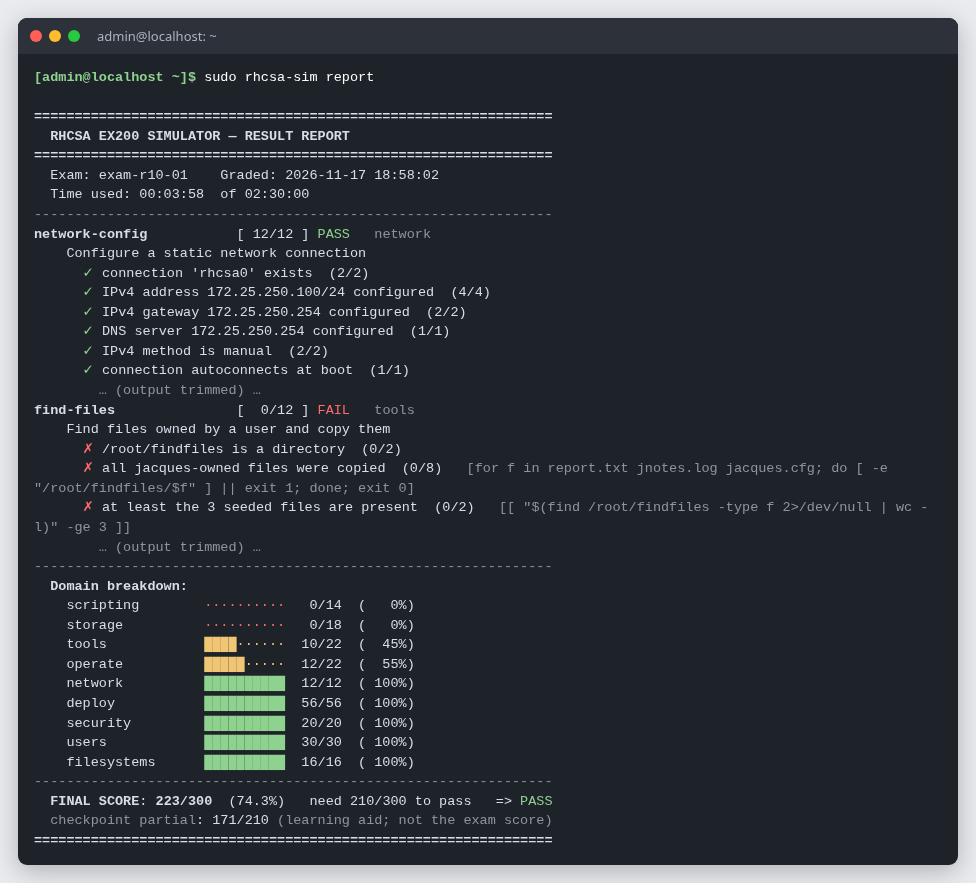

(For a quick check without rebooting, use `sudo rhcsa-sim grade`.)

### 3.5 Reset for the next attempt

```bash
sudo rhcsa-sim reset       # answer y
```

This wipes the exam's changes and returns the spare disk to blank. Your scores and
history are kept. Reverting your VM snapshot works too.

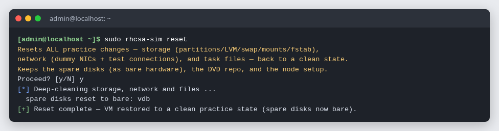

---

## 4. Two-node exam

You need **two VMs** prepared as in [step 1](#1-prepare-the-vm) and installed as in
[step 2](#2-install-the-simulator). Both must run the same RHEL version and reach
each other over the network. You decide which one is **node1** (you work from
it) and which is **node2**.

This guide uses these addresses. **Use your own.** Find each VM's address with
`hostname -I`.

| | IP in this guide |
|---|---|
| node1 | `192.168.122.185` |
| node2 | `192.168.122.22` |

### 4.1 Let node1's root log in to node2 (once)

node1 controls node2 over SSH, so node1's **root** needs key-based access to
node2's **root**. RHEL does not allow root password logins over SSH, so you copy
the key through your admin account. On **node1**:

```bash
sudo -i                                                       # become root on node1
[ -f /root/.ssh/id_ed25519 ] || ssh-keygen -t ed25519 -N '' -f /root/.ssh/id_ed25519
ssh -t admin@192.168.122.22 "sudo mkdir -p /root/.ssh; echo '$(cat /root/.ssh/id_ed25519.pub)' | sudo tee -a /root/.ssh/authorized_keys; sudo restorecon -RF /root/.ssh"
ssh root@192.168.122.22 hostname                               # must print node2's name, NO password prompt
exit                                                           # back to your admin user
```

Replace `admin@192.168.122.22` with your admin user and node2's IP. The `ssh -t`
line asks for that user's SSH password and then their `sudo` password on node2.
Answer `yes` if asked to trust node2's host key.

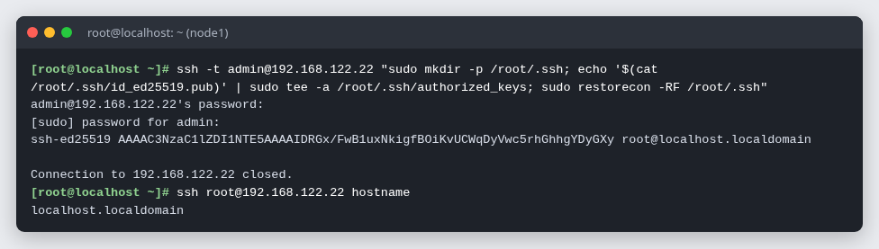

### 4.2 Pair the nodes

Tell each VM its role and the other VM's IP:

```bash
sudo rhcsa-sim node-setup --role node1 --peer 192.168.122.22     # on node1 (peer = node2's IP)
sudo rhcsa-sim node-setup --role node2 --peer 192.168.122.185    # on node2 (peer = node1's IP)
```

This renames the VMs `node1.example.com` and `node2.example.com`, adds both
names to `/etc/hosts`, and sets up the account node1 uses to seed and grade node2.

| on node1 | on node2 |
|:---:|:---:|
| 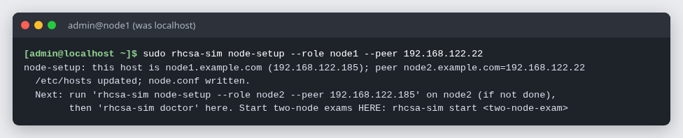 | 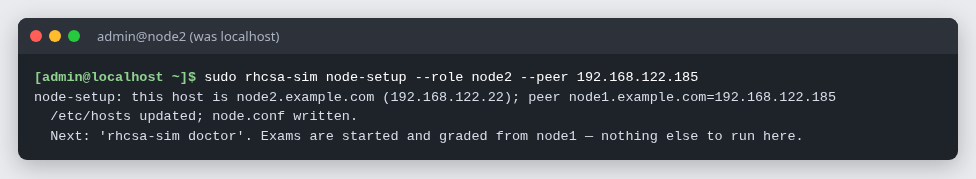 |

### 4.3 Check both are ready

Run on **both** VMs. Every line must be green. On node1 the last check must
say **`controller channel to node2 works`**:

```bash
sudo rhcsa-sim doctor
```

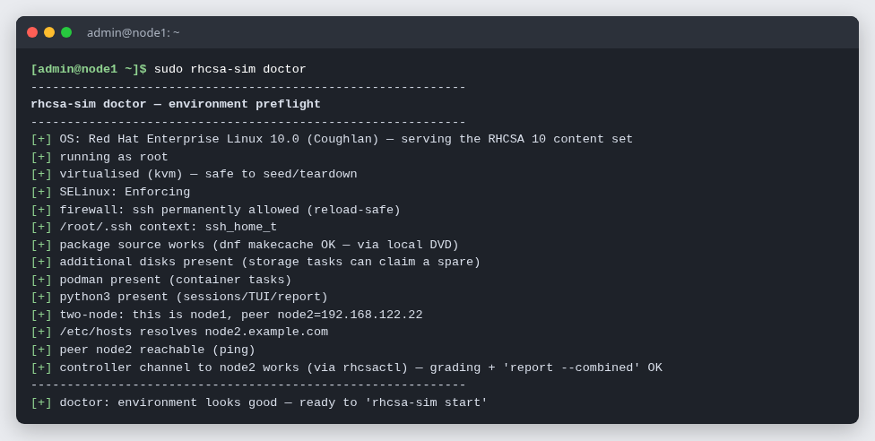

**Snapshot both VMs now.** This paired, clean state is the best restore point.

### 4.4 Start a two-node exam (on node1)

From here on, **run every `rhcsa-sim` command on node1**. It seeds, grades and
resets node2 for you.

```bash
sudo rhcsa-sim start exam-r10-2node-01     # RHEL 10.  On RHEL 9: sudo rhcsa-sim start exam-2node-01
```

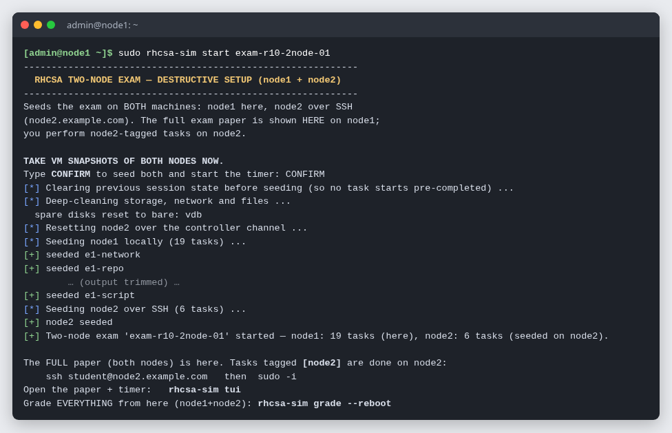

### 4.5 Open the paper and do the tasks

```bash
sudo rhcsa-sim tui        # on node1; on a headless node1, use the SSH tunnel from 3.2
```

The paper lists **node1's tasks** and **node2's tasks** separately. Do each group
on its own VM:

- **node1 tasks:** on node1, as root (`sudo -i`).
- **node2 tasks:** from node1, `ssh student@node2.example.com` (password
  `password`), then `sudo -i`. Do node2's **root-password** task on node2's
  **console**.

| Two-node paper | *Important configuration information* |
|:---:|:---:|
| 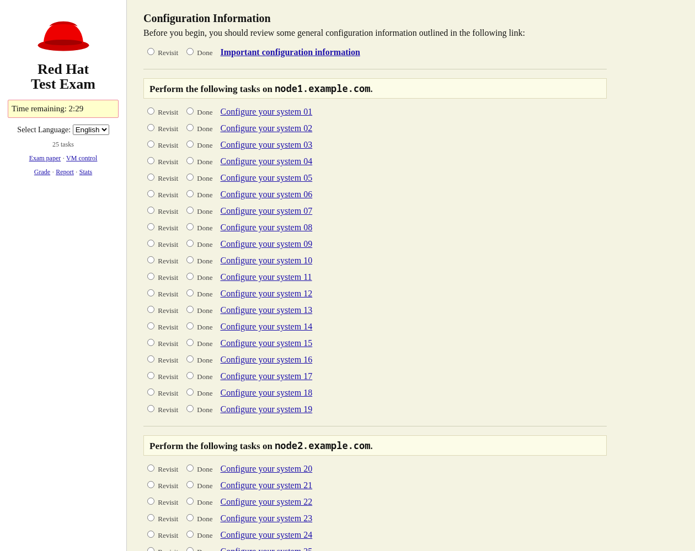 | 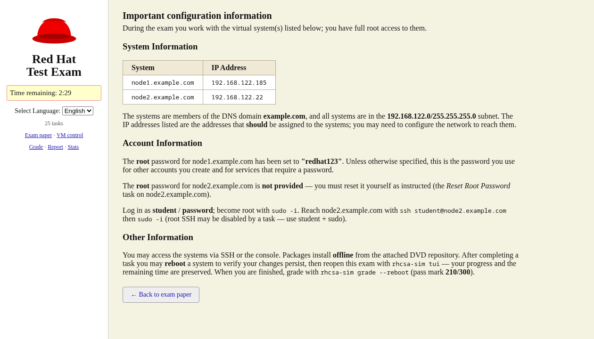 |

**VM control** (sidebar) shows each node's status and can reboot, shut down,
open a console or rebuild a node, like the real exam's VM manager. A node that is
**shut off** has to be started from your hypervisor.

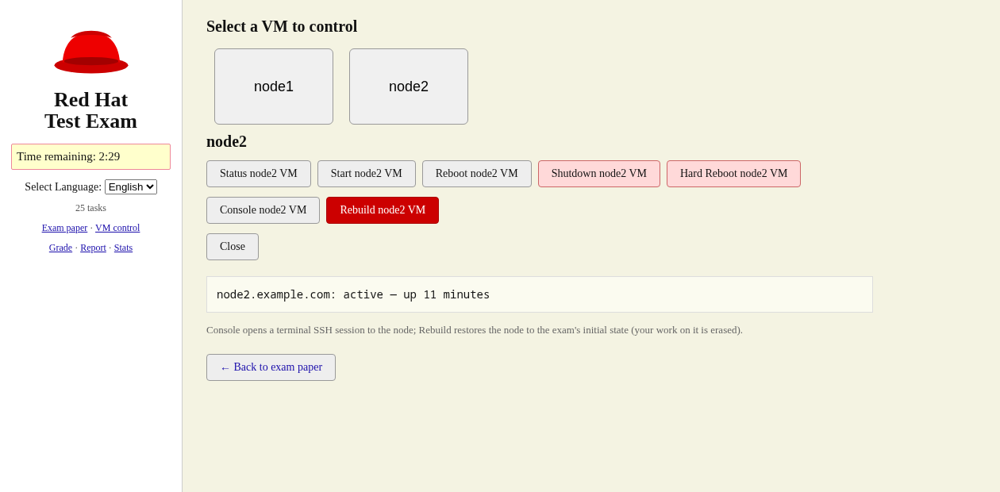

### 4.6 Grade both nodes (on node1)

```bash
sudo rhcsa-sim grade --reboot
```

Both VMs reboot and each grades itself after boot. When both are back up (about
2 minutes), get the combined score on node1:

```bash
sudo rhcsa-sim report --combined
```

| grade --reboot | report --combined |
|:---:|:---:|
| 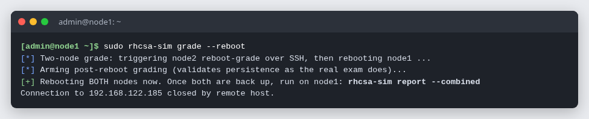 | 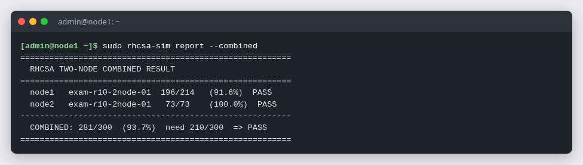 |

For a full per-task breakdown (before you reset), run `sudo rhcsa-sim report` on
node1 for node1's tasks, and on node2 for node2's tasks.

### 4.7 Reset both nodes (on node1)

```bash
sudo rhcsa-sim reset       # answer y. Cleans node1 AND node2; pairing and history are kept.
```

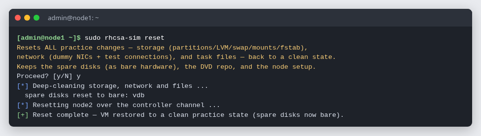

---

## 5. Practice modes

Exams are aid-free. Practice modes add a **Hint**, the full **Solution** (with your
task's real values) and **Check my work** to every task:

| Goal | Command |
|---|---|
| Practise one topic (untimed, with aids) | `sudo rhcsa-sim practice users` |
| Practise a whole paper with aids | `sudo rhcsa-sim start exam-r10-01 --practice` |
| Retry what you failed or haven't tried | `sudo rhcsa-sim practice weak` |
| One random task against a 7-minute clock | `sudo rhcsa-sim drill` |
| Fix a deliberately broken system | `sudo rhcsa-sim troubleshoot` |
| Aid-free rehearsal that counts toward readiness | `sudo rhcsa-sim mock` |
| Read a topic with every worked solution | `sudo rhcsa-sim study users` |
| See your progress and weak areas | `sudo rhcsa-sim stats` |

Topics: `deploy filesystems network operate scripting security storage tools users`
(plus `containers` on RHEL 9). Open the paper the same way, with `sudo rhcsa-sim tui`:

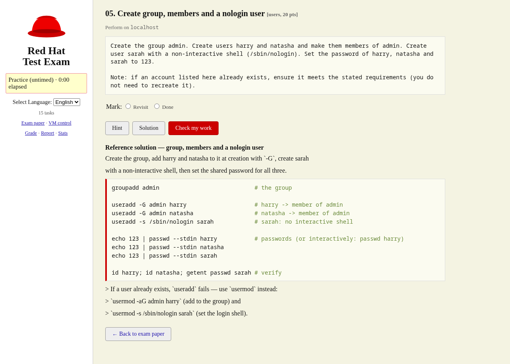

`practice storage` seeds one storage task per **blank spare disk**. Attach more
spare disks to get more storage tasks per round. More practice tips are in
**[PRACTICE.md](PRACTICE.md)**.

---

## Updating

The simulator runs from its installed copy in `/opt/rhcsa-sim`, so downloading a
new version changes nothing until you reinstall. Do this on every VM:

```bash
curl -LO https://github.com/ambawatyuvaraj/rhcsa-exam-simulator/archive/refs/heads/main.tar.gz
rm -rf rhcsa-exam-simulator-main && tar xzf main.tar.gz
cd rhcsa-exam-simulator-main && sudo ./install.sh
```

(With a git clone: `git pull` then `sudo ./install.sh`.) Your history and stats
in `/var/lib/rhcsa-sim` are kept, and so is the two-node pairing.

## Troubleshooting

| You see | Fix |
|---|---|
| `git: command not found` | Download with `curl` as shown in [step 2](#2-install-the-simulator). |
| doctor: `no working package source` / `package source NOT working` | Attach the RHEL DVD ISO to the VM as a CD-ROM, then `sudo rhcsa-sim local-repo`. |
| doctor: `no spare disk detected` | Add a blank virtual disk to the VM (don't partition it), or reinstall RHEL using only the first disk. |
| `no tasks found` or `needs a blank spare disk` in `practice` | Every task in that topic needs a blank disk and none is free. Run `sudo rhcsa-sim reset`, or attach another blank disk. |
| `'exam-…2node…' is a two-node exam — pair two VMs first` | Use a single-node paper (no `2node` in the name), or pair two VMs ([step 4](#4-two-node-exam)). |
| `… is a RHCSA 9 paper, but this system is RHEL 10` | Papers follow the OS. Run `sudo rhcsa-sim list` for the papers on this VM. |
| `tui` prints an address but no browser opens | The VM has no desktop. Use the SSH tunnel in [3.2](#32-open-the-exam-paper), or `sudo rhcsa-sim tui --text`. |
| doctor on node1: `controller channel to node2 not set up` | Redo [4.1](#41-let-node1s-root-log-in-to-node2-once): from node1 as root, `ssh root@<node2-ip> hostname` must work without a password. Then re-run `node-setup` on both VMs. |
| doctor: `peer node2 not reachable` | The VMs can't reach each other. Put both on the same network and check `ping <node2-ip>` from node1. |
| Two-node: VM IPs changed (DHCP) | Re-run both `node-setup` commands with the new IPs, then `doctor`. |
| You can't log in as root any more | A paper's *reset the root password* task scrambled it. Use your admin account or `student` / `password`, and reset root from the console. |
| Anything else is badly broken | Revert the VM snapshot(s), or `sudo rhcsa-sim reset`. |

## RHCSA 9 vs. RHCSA 10

Red Hat re-based the EX200 exam on RHEL 10. **The simulator matches whichever
RHEL version it runs on.** Every paper, practice topic and troubleshooting
scenario comes from that version's objectives.

| | RHCSA 9 | RHCSA 10 |
|---|---|---|
| **Flatpak** | — | **New.** Configure a Flatpak remote and install apps, offline from a repo built off the RHEL 10 DVD. |
| **Task scheduling** | cron, at | cron, at, **systemd timer units** |
| **Partitioning** | MBR + GPT | **GPT only** |
| **Containers (podman)** | included | **removed** (no longer an objective) |
| **Set-GID collaboration dirs** | included | **removed** |
| Repos, packages, LVM, networking, firewalld, SELinux, users, storage, scripting | ✓ | ✓ |

## Requirements

- One VM (single-node) or two VMs (two-node) running RHEL 9 or 10 (or Rocky /
  AlmaLinux / CentOS Stream 9|10), 2 GB RAM each, an OS disk plus one blank spare disk.
- The matching RHEL install DVD ISO attached to each VM.
- Internet access once, to download the simulator.
- Optional: a desktop (*Server with GUI*) on node1 to open the exam paper in Firefox
  directly. Otherwise use the SSH tunnel or `tui --text`.

## License

MIT — see [LICENSE](LICENSE).
